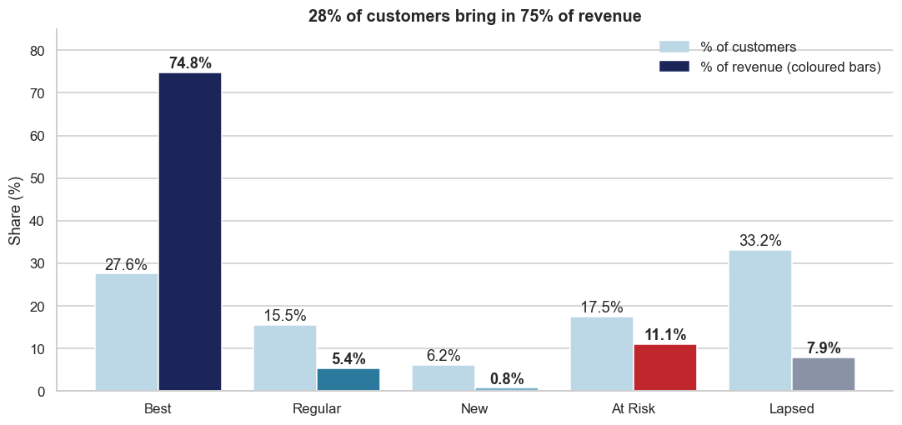
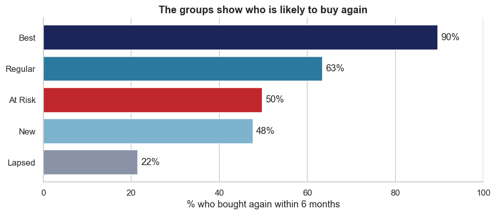

# Online Retail Customer Segments

Which customers should a business keep, win back or stop chasing? This project groups the customers of a UK online gift shop and tests whether those groups show who will buy again.

**Tools:** Python (pandas), SQL (SQLite), Matplotlib, Seaborn

**[View the full analysis notebook](customer_segments.ipynb)**

## Key findings

- **Best customers bring most of the money:** 28% of customers bring in 75% of revenue.
- **At Risk customers are worth saving:** 1,020 customers have spent £1.8M but haven't bought for 3 to 12 months.
- **A small group matters most:** the top quarter of At Risk customers (255) spent £1.2M, or 64% of that group's total.
- **The groups are useful:** in a test on earlier data, 90% of Best customers bought again within 6 months, compared with 22% of Lapsed customers.





## The customer groups

| Group | Rule | Customers | Share of revenue |
|---|---|---:|---:|
| **Best** | Bought in the last 90 days, 5 or more orders | 1,611 | 74.8% |
| **Regular** | Bought in the last 90 days, 2 to 4 orders | 906 | 5.4% |
| **New** | Bought in the last 90 days, 1 order | 360 | 0.8% |
| **At Risk** | Last bought 91 to 365 days ago, 2 or more orders | 1,020 | 11.1% |
| **Lapsed** | Last bought over a year ago, or 1 order more than 90 days ago | 1,935 | 7.9% |

## Recommendations

1. **Best:** protect them first, and watch for any who stop buying.
2. **At Risk:** contact the 255 highest-spending customers first. In the test, 65% of this type bought again.
3. **New:** encourage a second order soon after the first.
4. **Lapsed:** use low-cost contact only.
5. **Before spending on win-back:** contact half of the 255 customers and hold back the other half at random, to see whether the contact actually changes anything.

## Data

The data is [Online Retail II](https://archive.ics.uci.edu/dataset/502/online+retail+ii) from the UCI Machine Learning Repository. It covers transactions from a UK online gift shop, from December 2009 to December 2011.

| Step | Rows |
|---|---:|
| Original rows | 1,067,371 |
| After removing exact duplicates | 1,033,036 |
| After removing missing Customer ID | 797,885 |
| After keeping real products only | 794,223 |
| After removing zero prices | 794,163 |

Returns are kept and subtracted from each customer's spending. Very large customers are kept, because they are real buyers. The data file isn't in this repository.

## Method

1. **Clean the data:** combined the two sheets, removed duplicates, and handled returns and non-product rows.
2. **Measure each customer in SQL:** days since last purchase, number of orders and net spending.
3. **Group customers:** used simple rules a manager can read.
4. **Test the groups:** grouped customers using data up to 9 June 2011, then checked who bought in the next 6 months. A second test date gave the same order.
5. **Prioritise:** ranked At Risk customers by past spending to decide who to contact first.

## Limitations

- **Past behaviour only:** the test shows who came back, not whether contacting them would help.
- **Christmas effect:** the 6-month test includes the Christmas season, so its rates are higher than usual.
- **Missing customers:** about 23% of rows have no Customer ID, so those sales aren't included.
- **Rule cut-offs are my choice:** changing them would change the group sizes.
- **Mostly UK, possibly wholesalers:** 84% of revenue is from the UK, and some customers buy large quantities.
- **Old data:** it ends in 2011, so this shows a method, not what today's customers would do.

## Repository structure

```text
├── customer_segments.ipynb   # Full analysis, with outputs
├── figures/                  # Charts
├── outputs/                  # Result tables, including the contact-first list
├── requirements.txt
└── README.md
```

## Run it yourself

1. Install the dependencies:

   ```bash
   pip install -r requirements.txt
   ```

2. Download `online_retail_II.xlsx` from [UCI](https://archive.ics.uci.edu/dataset/502/online+retail+ii) and put it next to the notebook.

3. Open the notebook and run all cells. Reading the file takes a few minutes.

   ```bash
   jupyter notebook customer_segments.ipynb
   ```

## Author

**Lilit Poghosyan**
